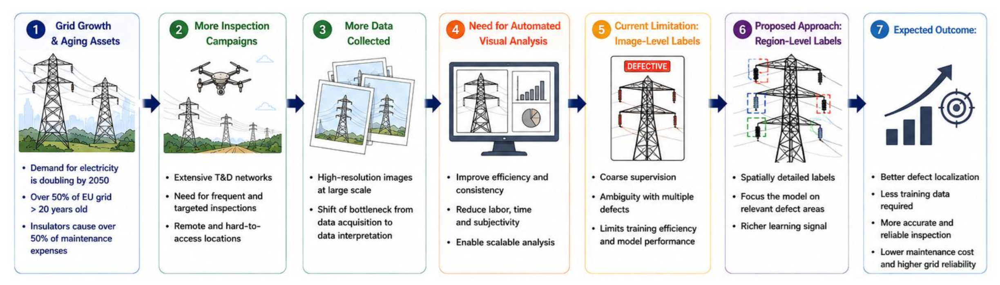
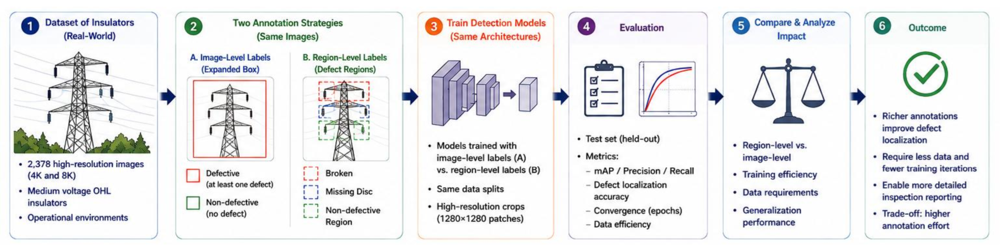
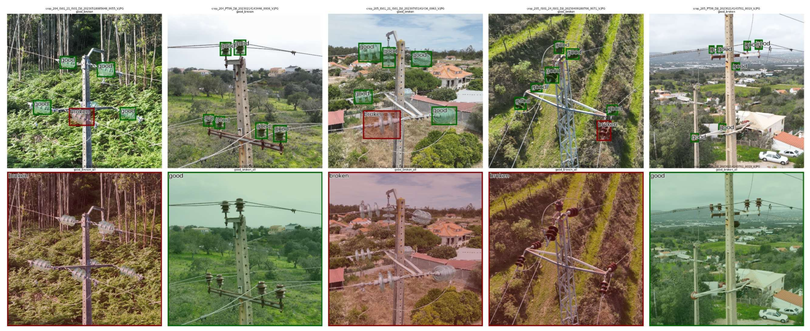
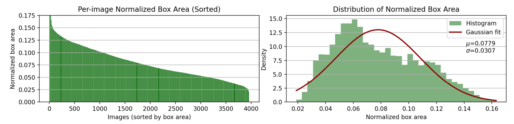
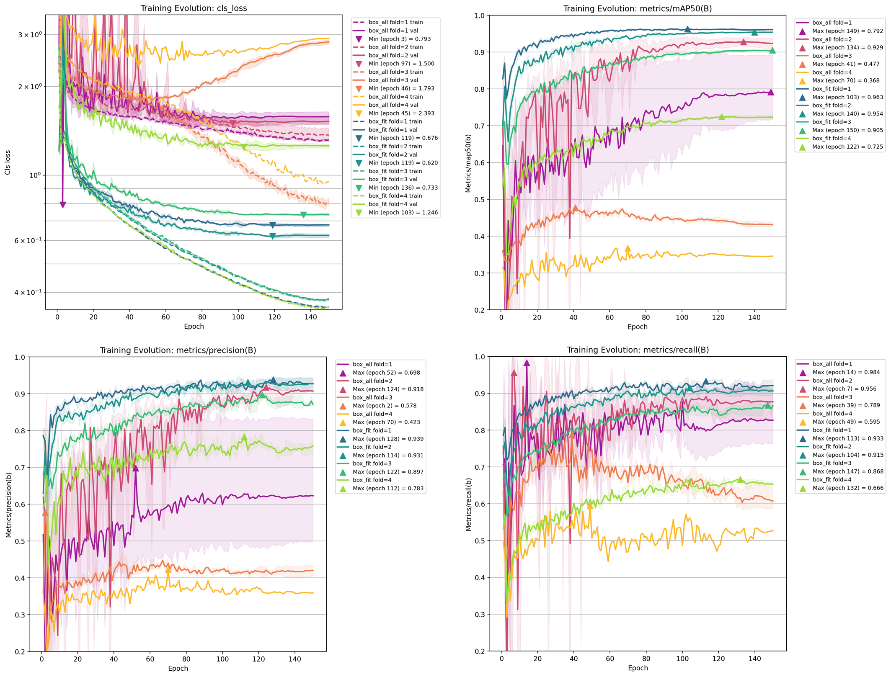
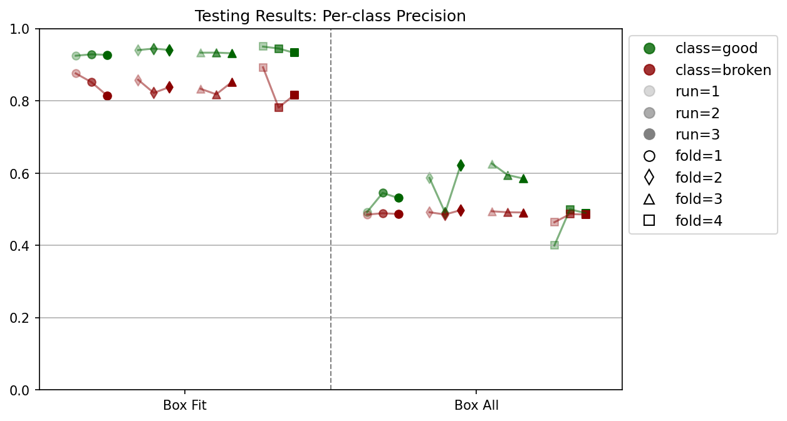
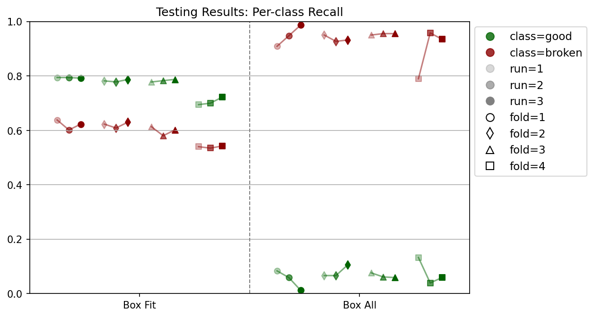
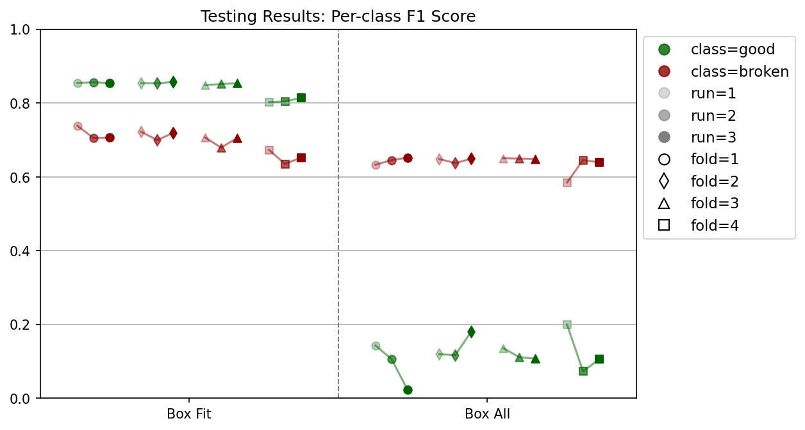
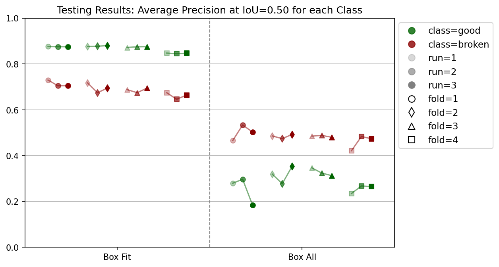
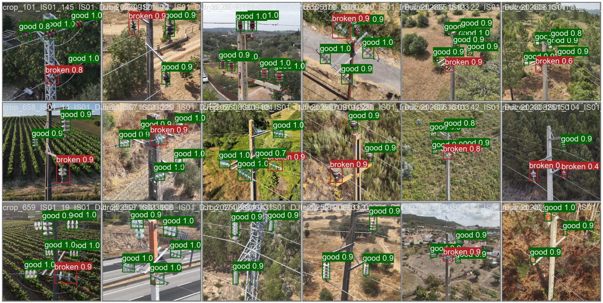

<!-- Add the paper text or supplementary notes. Markdown, math, and code are supported. -->

> **Copyright notice:** CIGRE Copyright © 2026. All rights reserved. This page provides a summary of the published paper. The published version is available via [e-CIGRE](https://www.e-cigre.org/publications/detail/b2-11096-2026-automating-electrical-grid-asset-inspections-improving-insulators-health-assessment-with-region-level-annotations.html). In accordance with the [CIGRE copyright provisions](https://cigre-usnc.org/wp-content/uploads/2017/03/CIGRE-COPYRIGHT-PROVISIONS.pdf) and the [CSE submission policy](https://cse.cigre.org/about/submission-procedure.html), authors are permitted to post a PDF copy of their published paper for self-archival on personal websites or similar outlets (e.g. ResearchGate).

---

## Context

Electrical grid reliability is becoming increasingly critical as electricity demand grows and infrastructure ages. More than 50% of the EU grid has been in operation for over 20 years. Insulators represent only 5–8% of installation costs, yet account for over 50% of maintenance expenditure. Manual visual inspection remains labor-intensive, time-consuming, and subject to operator variability.

<figure>
  
  <figcaption>
  Motivation: grid growth and asset aging increase inspection load, shifting the bottleneck from UAV-based data acquisition to data interpretation. Coarse image-level labels limit training efficiency, motivating spatially detailed region-level supervision.
  </figcaption>
</figure>

## Objective

This work quantifies the impact of annotation granularity on insulator defect detection. Using identical images, architectures, and training procedures, we compare:

- **Region-level supervision:** tightly fitted bounding boxes around each insulator (broken / good).
- **Image-level supervision:** full-image “clamped” boxes indicating only the presence or absence of a defect.

We evaluate effects on accuracy, convergence speed, data efficiency, and robustness.

## Problem Statement

Automated inspection models are increasingly used to support maintenance decisions, but existing annotation workflows were designed for asset condition reporting rather than model training. In particular:

- Image-level labels provide only coarse supervision, with no defect localization.
- Images containing multiple assets introduce ambiguity when healthy and defective insulators co-occur.
- It remains unclear how much richer spatial supervision improves learning, beyond localization itself.

## Methodology

- **Annotation comparison:** fitted boxes (region-level) vs. clamped boxes (image-level) on the same images.
- **Model:** YOLOv11-medium, trained for detection in both settings.
- **Protocol:** 4-fold cross-validation × 3 random seeds; 1280×1280 high-resolution crops; identical data splits and hyperparameters.

<figure>
  
  <figcaption>
  Methodology: controlled comparison of image-level and region-level supervision using identical images, architectures, and training splits. Evaluation covers test-set performance (mAP, precision, recall), defect localization, convergence, and data efficiency.
  </figcaption>
</figure>

## Dataset

- 4,756 annotated image variants collected between 2023–2025 in rural and suburban operational environments.
- 36,379 annotated ceramic and glass insulators (broken and non-defective).
- Real-world UAV imagery with diverse backgrounds, viewpoints, and asset scales.

<figure>
  
  <figcaption>
  Dataset examples (top: region-level fitted boxes for <em>good</em> and <em>broken</em>; bottom: corresponding image-level clamped labels). The same field images are used in both settings to isolate the effect of spatial supervision.
  </figcaption>
</figure>

<figure>
  
  <figcaption>
  Scale distribution: per-image normalized box area (sorted, left) and overall density with Gaussian fit (μ = 0.078, σ = 0.031, right). Insulators typically occupy a small fraction of the frame, underscoring the need for precise localization.
  </figcaption>
</figure>

## Key Findings

- **Higher accuracy and lower variability** with region-level supervision across folds and seeds.
- **Faster, more stable convergence:** lower classification loss and higher mAP@50, precision, and recall throughout training.
- **Consistent precision–recall gains,** particularly for larger, more visible assets.
- **Image-level supervision** was more susceptible to overfitting and spurious correlations, with high recall but low precision.

<figure>
  
  <figcaption>
  Training dynamics: classification loss (top-left) and validation mAP@50, precision, and recall (others) over 150 epochs. Fitted boxes (green/blue) converge faster and more stably than clamped boxes (purple/orange/red/yellow). Shaded bands denote variability across seeds.
  </figcaption>
</figure>

<figure>
  

    
    
    
    
  

  <figcaption>
  Test-set metrics per class (<em>good</em> vs. <em>broken</em>) across folds (marker shape) and runs (marker shade) — top-left: precision, top-right: recall, bottom-left: F1-score, bottom-right: AP@50. Box-Fit (region-level, left) substantially outperforms Box-All (image-level, right) with higher, more stable scores.
  </figcaption>
</figure>

<figure>
  
  <figcaption>
  Qualitative results: region-level model predictions on held-out operational imagery. Correct localization of <em>good</em> (green) and <em>broken</em> (red) insulators with confidence scores across diverse poles, landscapes, and lighting conditions.
  </figcaption>
</figure>

## Limitations

- Single defect type studied (broken insulators); multi-defect scenarios were not explored.
- Visible-light (RGB) imagery only; other modalities such as thermal or LiDAR were not tested.
- Evaluation limited to YOLOv11-medium; generalization to other architectures remains to be assessed.

## Practical Implications

- Spatial supervision improves feature learning, beyond localization alone.
- Richer annotations reduce data requirements and improve training stability.
- More reliable defect detection supports scalable, cost-effective automated inspections.
- The additional annotation effort is justified by measurable gains in performance and grid reliability.

## Future Work

- Extension to multi-defect and multi-asset scenarios.
- Integration of multimodal sensing (thermal, LiDAR).
- Semi-supervised and weakly supervised approaches to reduce annotation cost.

---

## Conference Poster

Presented at the CIGRE Paris Session 2026 by Ricardo Santos.

<iframe
  src="poster_11096_B2_PS2_ROCHA_PT.pdf#toolbar=0&view=Fit&navpanes=0"
  width="100%"
  style="aspect-ratio: 9/16; border: none;">
  
This browser does not support PDFs. Please download the PDF to view it:
    <a href="poster_11096_B2_PS2_ROCHA_PT.pdf">Download PDF</a>.
  

</iframe>

---

## Conference Paper

The published version is available in [CIGRE Session Materials](https://www.e-cigre.org/publications/detail/b2-11096-2026-automating-electrical-grid-asset-inspections-improving-insulators-health-assessment-with-region-level-annotations.html). 
A self-archived copy is provided below for scholarly use, in accordance with CIGRE policy.

<iframe
  src="paper_11096_B2_PS2_ROCHA_PT.pdf#toolbar=0&view=Fit&navpanes=0"
  width="100%"
  style="aspect-ratio: 1 / 1.414; border: none;">
  
This browser does not support PDFs. Please download the PDF to view it:
    <a href="paper_11096_B2_PS2_ROCHA_PT.pdf">Download PDF</a>.
  

</iframe>

---
