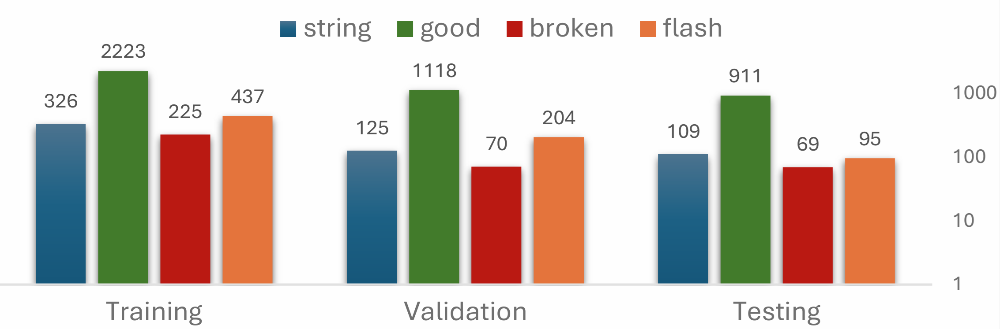
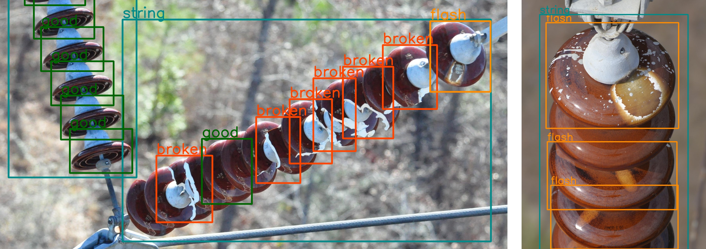
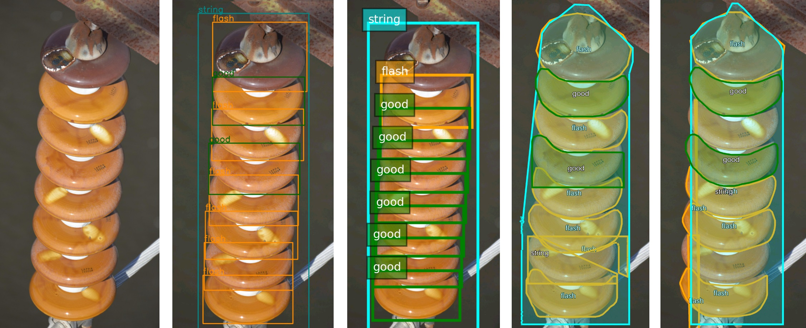
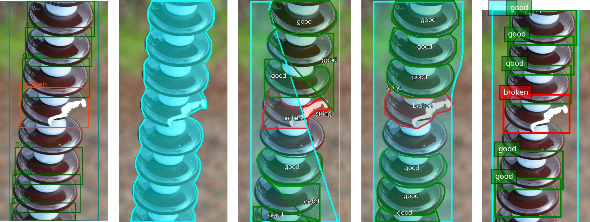
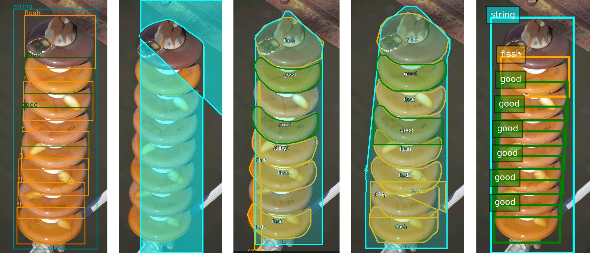

<!-- Add the paper text or supplementary notes. Markdown, math, and code are supported. -->
---

## Overview

<!-- TODO: drop your file in as graphical_abstract.pdf -->
<figure>
  <iframe
    src="graphical_abstract.pdf#toolbar=0&view=Fit&navpanes=0"
    width="100%"
    style="aspect-ratio: 1/0.99; border: none;">
    

      This browser does not support PDFs. Please download the PDF to view it:
      <a href="graphical_abstract.pdf">Download PDF</a>.
    

  </iframe>

  <figcaption>
  Pre-trained vs fine-tuned Florence-VL across captioning, detection, and segmentation of insulator defects.
  </figcaption>
</figure>

Exploration of multimodal large language models for industry-specific electrical grid inspection, evaluating Florence-VL before and after LoRA fine-tuning on insulator defect imagery.

### Background

- Manual inspections are time-consuming, costly, and prone to inconsistencies
- CNNs and ViTs automated visual inspection; vision models now evolve toward multimodal architectures
- MLLMs trained on internet data perform strongly on generic tasks but miss industrial nuances
- Generic datasets (ImageNet, COCO) fail on repetitive patterns, subtle defects, and low-contrast regions

### Challenges

- Specialized defect vocabularies (rust, flashover, broken disc) are missing from pre-trained models
- Captioning, grounding, and segmentation must work on high-resolution operational imagery
- GPT-4 gives accurate captions but lacks batch processing for proprietary data at scale
- Fine-tuning must run on standard hardware with limited domain data

### Approach

- Pre-trained vs fine-tuned Florence-VL with LoRA (rank 16, ~3.9M trainable params, 1.4%)
- Caption tasks: `<CAPTION>`, `<DETAILED CAPTION>`, `<MORE DETAILED CAPTION>` (GPT-4o ground truth)
- Region tasks: `<REGION PROPOSAL>`, `<OD>`, `<DENSE REGION CAPTION>`
- Grounded tasks: phrase grounding, referring-expression segmentation, region-to-segmentation

<figure>
  
  <figcaption>
  Annotation setup for region-related tasks from the insulator defect dataset.
  </figcaption>
</figure>

### Data

- **Dataset**
  - Insulator Defect Image Dataset (IDID): 400 unique images (1,600 with mirroring)
  - Classes: String Insulator, Good Disc, Broken Disc, Flashover Shell
  - Curated version: standardized names, deduplicated splits, annotated test set, Roboflow release

- **Splits**
  - Train: 300 images, 3,211 instances
  - Validation: 100 images, 1,517 instances
  - Test: 88 images, 1,184 instances

<figure>
  
  <figcaption>
  Canonical samples of each class and class distribution across splits.
  </figcaption>
</figure>

### Results

- Fine-tuning improves class recognition and object localization; captions stay simplistic
- Object detection mAP50 of 53.6% after fine-tuning (vs 89.7% YOLOv8 and 94.8% YOLO11 benchmarks)
- Referring-expression segmentation works on blurred backgrounds even pre-trained, with errors
- Region-to-segmentation often improves after fine-tuning, with mixed per-object results

<figure>
  
  <figcaption>
  Captioning and detection results for pre-trained and fine-tuned models.
  </figcaption>
</figure>

<figure>
  
  <figcaption>
  Referring-expression and region-to-segmentation results, example 1.
  </figcaption>
</figure>

<figure>
  
  <figcaption>
  Referring-expression and region-to-segmentation results, example 2.
  </figcaption>
</figure>

### Findings

- Domain-specific fine-tuning is required for industrial defect vocabularies
- Detection and segmentation transfer better than free-form captioning
- High-quality, consistently labeled data matters more than generic scale
- Tailored caption datasets are needed to close the semantic gap

---

## Conference Paper

<iframe
  src="paper_DSP_2025_HV_Insulators_MLLMs_Pedro_Daniel_Rocha.pdf#toolbar=0&view=Fit&navpanes=0"
  width="100%"
  style="aspect-ratio: 1 / 1.294; border: none;">
  
This browser does not support PDFs. Please download the PDF to view it:
    <a href="paper_DSP_2025_HV_Insulators_MLLMs_Pedro_Daniel_Rocha.pdf">Download PDF</a>.
  

</iframe>

---
