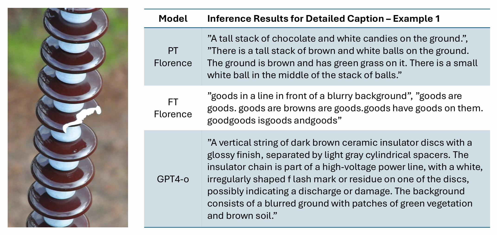
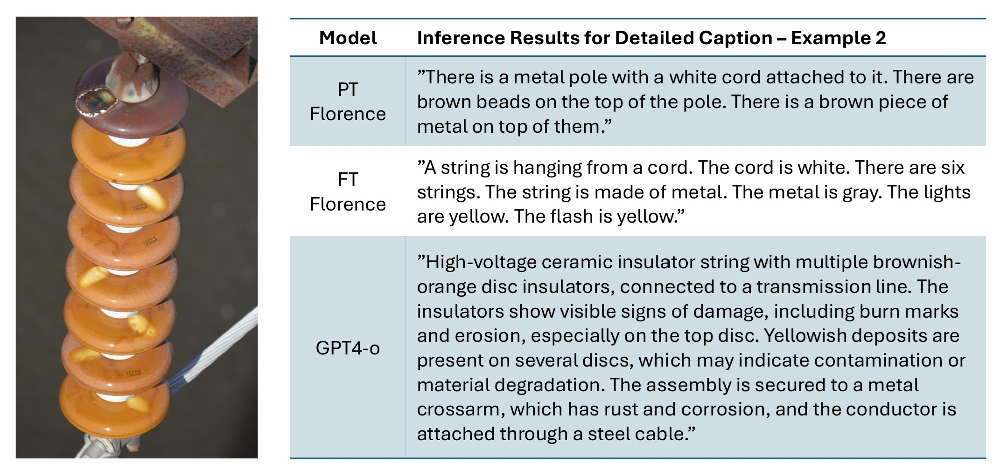
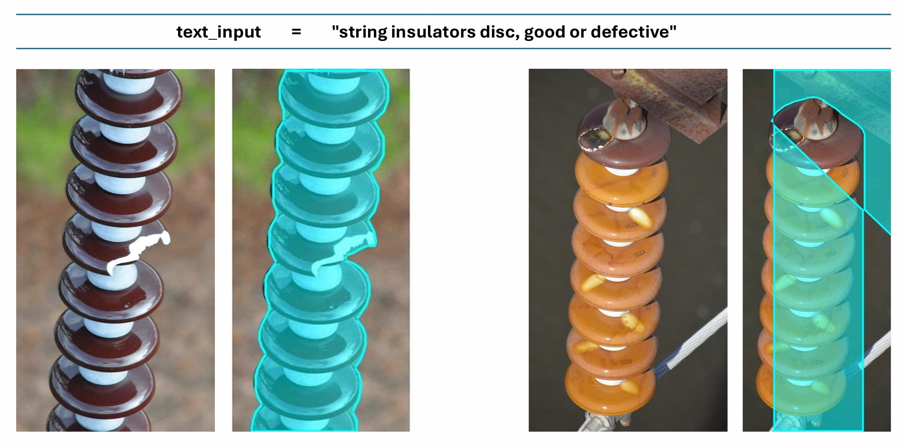
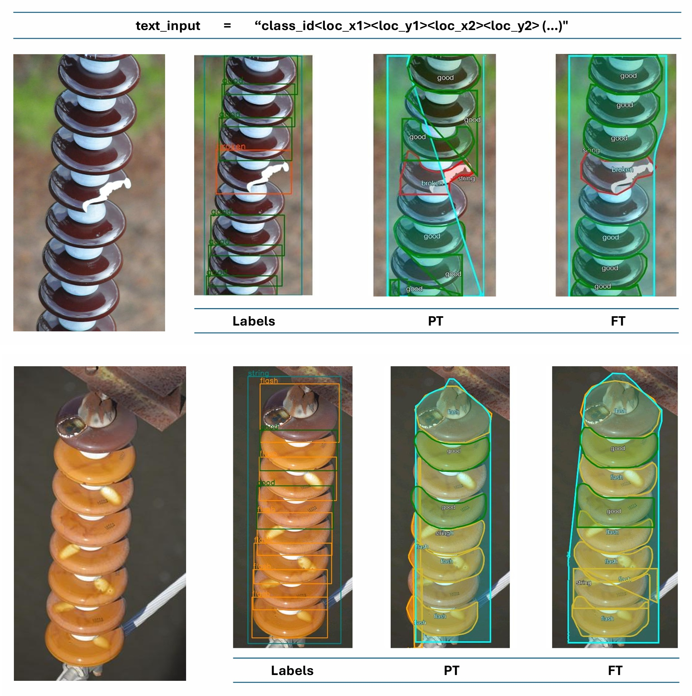
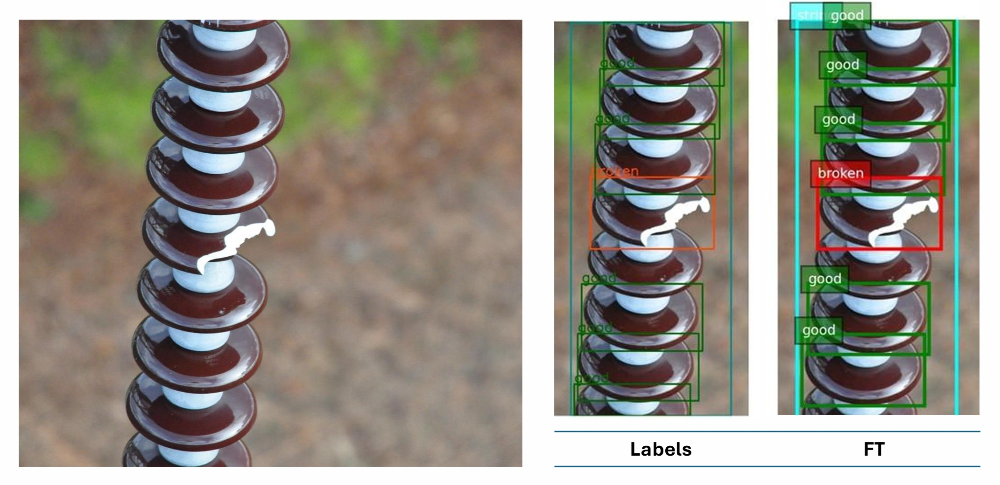
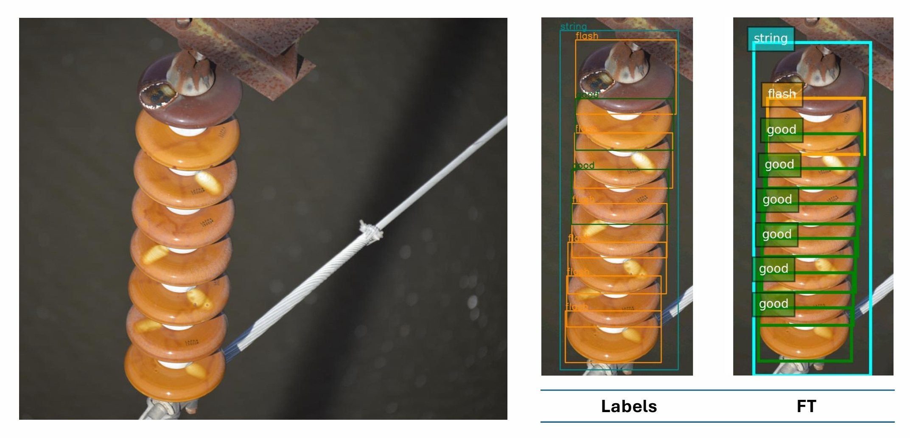

<!-- Add the paper text or supplementary notes. Markdown, math, and code are supported. -->
---

> **Copyright notice:** © 2025 IEEE. Personal use of this material is permitted. Permission from IEEE must be obtained for all other uses. The published version is available via [IEEE Xplore](https://doi.org/10.1109/DSP65409.2025.11075122).

---

## Overview

Simple comparative study: pre-trained vs fine-tuned Florence-2 on HV insulator inspection, across captioning, detection, and segmentation.

### Method

- **PT:** [Florence-2-base-ft](https://huggingface.co/microsoft/Florence-2-base-ft) evaluated zero-shot.
- **FT:** the same model LoRA-fine-tuned on curated [IDID](https://doi.org/10.21227/VKDW-X769) — 300 images, 3.1k region annotations, 4 classes.
- Ground truth: GPT-4o for captions, IDID annotations for detection and segmentation.

### Data

- **IDID:** 400 unique images (1,600 with mirroring); classes: String Insulator, Good Disc, Broken Disc, Flashover Shell.
- Splits: train 300 / 3,211 instances, valid 100 / 1,517, test 88 / 1,184.

<figure>
  
  
  <figcaption>
  Canonical samples of each class, with annotation counts per class across splits.
  </figcaption>
</figure>

### Results

#### Caption Tasks

- PT captions stay generic and often hallucinate off-domain objects; FT collapses to the trained class names with repetitive text.
- GPT-4o ground truth stays descriptive and domain-specific.

<figure>
  
  <figcaption>
  Detailed caption, example 1: PT vs FT against GPT-4o ground truth.
  </figcaption>
</figure>

<figure>
  
  <figcaption>
  Detailed caption, example 2: PT vs FT against GPT-4o ground truth.
  </figcaption>
</figure>

#### Segmentation

- Works on blurred backgrounds even pre-trained, with visible errors; fine-tuning improves masks but with mixed per-object results.

<figure>
  
  <figcaption>
  Phrase grounding to segmentation with the pre-trained model on a free-text defect description.
  </figcaption>
</figure>

<figure>
  
  <figcaption>
  Region-to-segmentation: ground-truth labels vs pre-trained vs fine-tuned masks.
  </figcaption>
</figure>

#### Object Detection

- Fine-tuning improves class recognition and object localization, but the model still confuses flashover with good discs.

| Work     | Model            | # Params | mAP@50 |
|----------|------------------|----------|--------|
| Ours     | Florence-2-base  | 0.23B    | 53.6%  |
| [1]      | YOLOv8s          | 11.2M    | 89.7%  |
| [2]      | YOLO11l          | 20.1M    | 94.8%  |

- [1] [SmartGridComm 2024](https://doi.org/10.1109/SmartGridComm60555.2024.10738034) — YOLOv8s on HV insulators.
- [2] [ISPA 2025](https://doi.org/10.1109/ISPA66905.2025.11259463) — YOLOv11-large on the same dataset.

Multimodal models remain well behind these specialist CNN detectors, despite comparable or larger parameter counts — a key limitation for inspection use.

<figure>
  
  <figcaption>
  Detection example 1: ground-truth labels vs FT output — broken disc and surrounding good discs recovered.
  </figcaption>
</figure>

<figure>
  
  <figcaption>
  Detection example 2: ground-truth labels vs FT output on a flashover string.
  </figcaption>
</figure>

### Takeaways

- Fine-tuning is required for industrial defect vocabularies, but captions remain simplistic.
- Detection and segmentation transfer better than free-form captioning.
- Specialist CNN detectors still outperform MLLMs on detection accuracy.

---

## Conference Paper

A self-archived accepted manuscript is provided below.  
The published version is available in [IEEE Xplore](https://doi.org/10.1109/DSP65409.2025.11075122).

<iframe
  src="paper_DSP_2025_HV_Insulators_MLLMs_Pedro_Daniel_Rocha.pdf#toolbar=0&navpanes=0&view=Fit"
  width="100%"
  style="aspect-ratio: 1 / 1.294; border: none;">
  
This browser does not support PDFs. Please download the PDF to view it:
    <a href="paper_DSP_2025_HV_Insulators_MLLMs_Pedro_Daniel_Rocha.pdf">Download PDF</a>.
  

</iframe>

---

## Conference Slides

<iframe
  src="slides_DSP_2025_HV_Insulators_MLLMs_Pedro_Daniel_Rocha.pdf#toolbar=0&navpanes=0&view=Fit"
  width="100%"
  style="aspect-ratio: 4/3; border: none;">
  
This browser does not support PDFs. Please download the PDF to view it:
    <a href="slides_DSP_2025_HV_Insulators_MLLMs_Pedro_Daniel_Rocha.pdf">Download PDF</a>.
  

</iframe>

---
