> **Open access:** This article is published in *IEEE Access*, Vol. 13, pp. 201392–201438 (2025). DOI: [10.1109/ACCESS.2025.3636718](https://ieeexplore.ieee.org/document/11267386/). The accepted version is provided [below](#journal-paper) under CC-BY-4.0.

---

## Presentation Video

!-- Graphical abstract video: replace ID once published on YouTube --
!--  --

## Overview

### Introduction

**External Motivation**
- Demand doubling toward 50,000 TWh/yr by 2050 with 80% wind/solar growth; T&D expected beyond 160M km; EU REPowerEU and DSO pressure on maintenance.
- Over half of EU grid older than 20 years; wear failures accelerate near end of life; insulators are 5–8% of install cost yet over 50% of maintenance.
- Scale: PV at 1 TW (≈5B m²) with billion-dollar O&M; wind beyond 900 GW (≈4M blades of 50–100 m); hydro ≈14% of power with thousand-m² dam walls.
- Manual collection/analysis no longer economical; drones cut inspection cost (e.g. major savings on lines, pipelines, PV, wind); IEEE 1808 pushes automated asset management.

**Related Work**
- PV, wind-blade, dam-wall, and power-line surveys each cover their asset well but stay in silos.
- Recurring gaps addressed here: platform×sensor redundancy treated as separate categories, annotation quality underexplored, no transfer from general vision advances, weak operational-viability analysis.

<figure>
  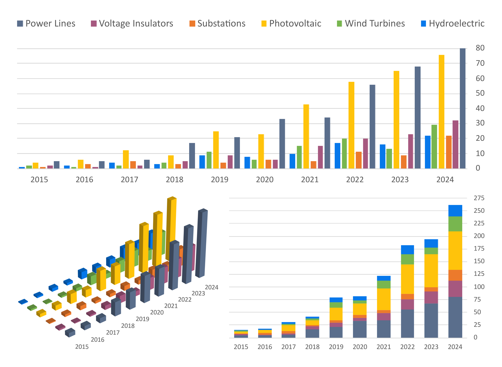
  <figcaption>
  Different illustrations of the count of published articles on electrical grid asset visual inspection over the past decade.
  </figcaption>
</figure>

**Review Methodology**
- Systematic search (Web of Science, ScienceDirect, IEEE Xplore, 2015–2024) with Boolean asset×vision×AI queries; PRISMA screening down to 67 studies, 45 datasets, 73 models, ranked by citations, venue, rigor, and task diversity.

<figure>
  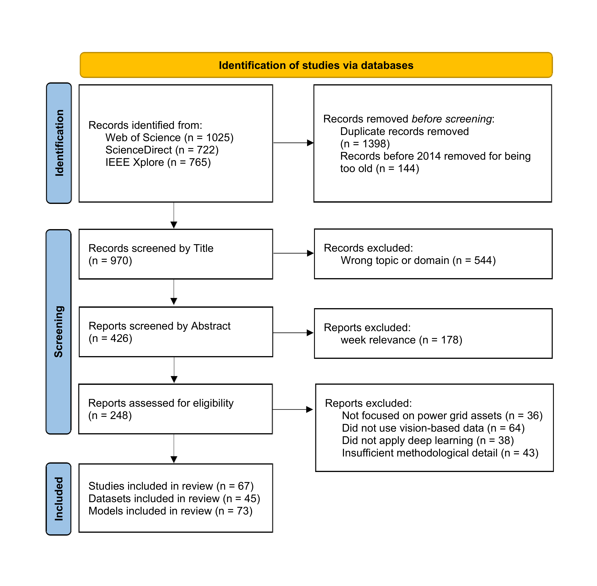
  <figcaption>
  PRISMA 2020 flow diagram of the literature selection process, showing the number of records identified, screened, assessed for eligibility, and included in the review.
  </figcaption>
</figure>

- Bibliometric mapping shows deep learning with object/defect detection as the mature axis, YOLO variants consolidating, renewables diversifying; weak links between diagnosis and operational decisions and across sensors motivate multimodal work.

<figure>
  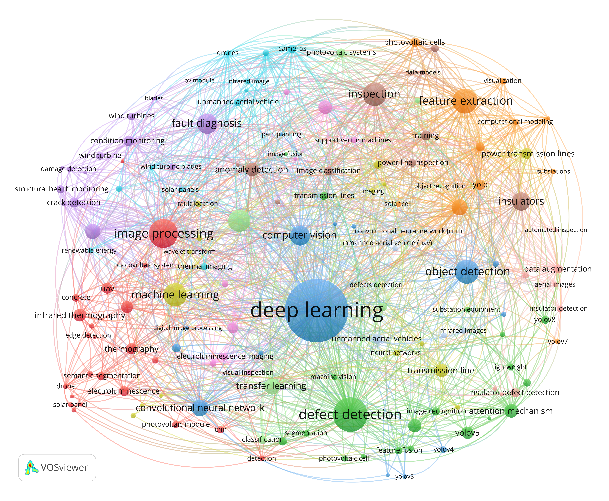
  <figcaption>
  Network visualization of co-occurring keywords in the computer vision and power line inspection literature. Node size represents keyword frequency, and link thickness indicates co-occurrence strength.
  </figcaption>
</figure>

**Main Contributions**
- Multi-asset coverage with shared technologies/practices; academic plus maintenance-management perspective.
- Four-dimensional framework (assets, means, sensors, algorithms) with task/data/model sub-dimensions to remove tree-taxonomy redundancy.
- Consolidation of 250+ references into diagrams plus in-depth synthesis of core works, datasets, and models per asset.
- Bottleneck analysis (data, annotation, validation, metric–operation gap) and integrated embedded + multimodal + active-learning proposal.

<figure>
  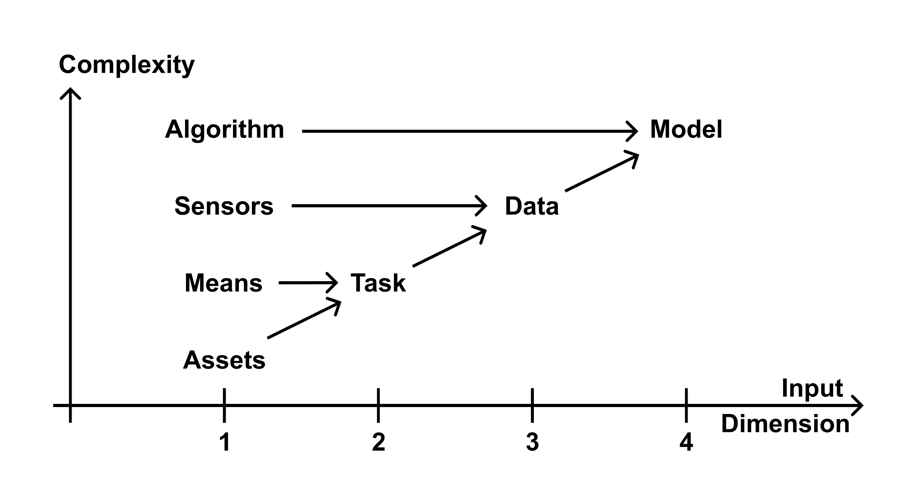
  <figcaption>
  Relationships and classification of considered system dimensions. The input dimension axis ranks each domain by the number of its primary dependencies, while their combination increases complexity.
  </figcaption>
</figure>

**Document Structure**

<figure>
  
  <figcaption>
  Overview of the document structure conceptualization, from visual inspections through acquisition and processing to applications, challenges, future directions, and conclusion.
  </figcaption>
</figure>

### Visual Inspections

Visual inspection is the most direct non-destructive testing method, now extended beyond the naked eye by digital cameras, drones, and computer vision that translate non-visible signals and automate decisions past fatigue and subjectivity. The model depends on algorithm and data; data on sensor and task annotations; task on asset defects and inspection means — isolating stages without careful interfaces creates emergent failures, and the field's model-centric bias has undervalued data.

<figure>
  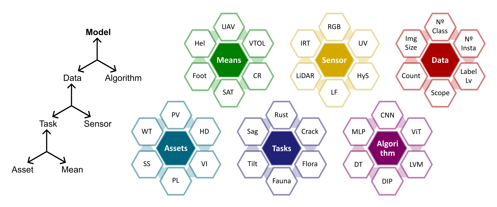
  <figcaption>
  Overview of the existing dimensions and corresponding domain samples relevant to inspection system modeling. Assets domain includes: Photovoltaics, Wind Turbines, Hydroelectric Dams, Power Lines, Voltage Insulators, and Substations. Means domain includes: UAVs, Helicopters, VTOL Aircrafts, Foot Patrols, Satellites, and Climbing Robots. Tasks domain includes detection of: Rust, Cracks, Vegetation, Bird Nests, Tilting of structures, and Sagging of power cables. Sensors domain includes: Visible Image, Infrared Thermography, Ultraviolet Imaging, LiDAR, X-Ray, and Hyperspectral. Data characteristics domain includes: Image Size, Number of images, Classes and instances, Level of label detail, and data Scope diversity. Algorithms domain includes: Digital Image Processing, Decision Trees, Multi-Layer Perceptrons, Convolutional Neural Networks, Vision Transformers, and Large Vision Models.
  </figcaption>
</figure>

**Electrical Systems**
- PV plants (arrays/panels/modules/cells, crystalline vs. thin-film): photons excite electron-hole pairs at the N–P junction; shading reverses cells into resistors causing hotspots, burnout, fire risk; even slight shading can collapse string output, mitigated by bypass diodes and half-cut designs.
- Insulators (cap-and-pin discs cemented into strings to ~120 kN): coastal/industrial pollution plus moisture forms conductive layers; field strength beyond ~3 kV/mm ionizes air; pollution can collapse flashover voltage tenfold with dry-band staining; ceramic/polymer favor flashover over puncture while heat-treated glass shatters visibly, keeping the string intact.

**Inspected Assets**
- Generation assets are large, uniform, repeatable: PV fixed geometry with intrusive electroluminescence for minor defects; blades medium with scale-variable defects detectable partly in motion; dam walls large with submerged faces needing waterproof platforms.
- Network assets are variable, 3D, multi-view: lines/towers span heights and shapes in remote sites; insulators and fittings are small/tiny with limited exposed surface needing close range; substations are dense and fixed, suiting permanent infrared/ultraviolet monitoring.
- Standards anchor practice: IEEE 1808 for collection, GIS compatibility, risk, and AI anomaly detection; IEC TS 62446-3 for PV thermography conditions, interpretation, and reporting.

**Process Automating**
- Pipeline: management strategy → work plan (resources, locations, schedules) → collection (RGB, infrared, ultraviolet, LiDAR) → analytic processing (missing/broken/flashed/loose/corroded/dirty/vegetation/nests) → quality reporting (structures, severity, repair suggestion) → repair/replace/reinstall/clean/clear.
- Bottlenecks are on-site collection and analytic processing; manual work is slow, skilled, and inconsistent, and more volume without recall gains only deepens the interpretation backlog.
- Automate progressively like driving levels: formalize protocols first, then encode operator instincts (glare avoidance, wind/EMI response, obstacle handling); PV with cataloged failure modes is most viable, highly variable assets favor hybrid human oversight.

<figure>
  
  <figcaption>
  Overview of the current electrical grid inspection workflow. The assets to be inspected are determined by the management strategy, which leads to inspection plans detailing the required resources. Data collection follows, using appropriate technologies for each task. The data is then processed to identify defects, producing a report on asset quality and condition to guide potential replacements and repairs.
  </figcaption>
</figure>

### Data Acquisition

Data is spatial visual information (pixels/voxels: visible, thermal, depth, point clouds) from a sparse combination of sensor, platform, and asset. Four elementary input dimensions define the model: assets, means, sensors, algorithms — with task as assets×means and data as task×sensors.

**Technologies and Sensors**
- Visible imaging (400–700 nm, CMOS standard): high-resolution color for corrosion, deformation, missing parts, foreign objects; limited by fog, glare, and low contrast.
- Infrared thermography (8–14 µm, cooled sensitive vs. uncooled compact): overheating, loose joints, degraded insulation, PV hotspots; corrected for emissivity, angle, distance, dirt, atmosphere, wind cooling.
- Ultraviolet (240–260 nm, solar-blind): corona discharge at sharp/high-gradient points; guides cleaning before polymer degradation and failure.
- Point clouds (LiDAR time-of-flight or photogrammetry): tower tilt, sag, clearance, vegetation; precise but calibration-, overlap-, and compute-heavy.
- Luminescence (ultraviolet fluorescence, photo- and electroluminescence): PV microcracks and series resistance at high resolution; needs dark/controlled biasing and filtering against background.
- Multi/hyperspectral (few vs. hundreds of bands): vegetation indices and encroachment at scale, insulation aging, transformer oil leaks including UV-induced fluorescence.
- X-ray radiography: internal cracks, voids, gas, insulation faults in transformers/breakers/cables without disassembly; costly, safety-constrained, now increasingly portable.

<figure>
  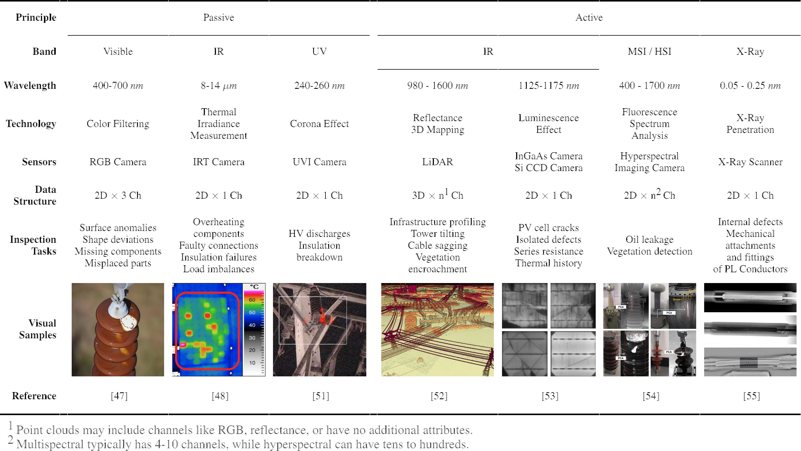
  <figcaption>
    Overview of Visual Sensing Technologies for Electrical Grid Asset Inspection Tasks.
  </figcaption>
</figure>

**Means and Platforms**
- Stationary structures give continuous high-resolution monitoring with standard sensors but narrow coverage; satellites give global on-demand coverage at 0.25–0.5 m/pixel but with cost, latency, weather, and resolution limits — continuous fixed sensing pays mainly for critical substations/transformers.
- Foot patrols adapt to dense/vegetated/indoor sites with bottom-up detail but are slow and risky; road vehicles speed distributed surveys passively along drivable paths but miss elevated assets.
- Helicopters cover remote lines fast with heavy multi-sensor payloads but at high cost and staffing needs; climbing robots inspect live conductors closely but slowly on-wire; multirotors hover precisely with quick deploy but short endurance; fixed-wing spans long corridors fast but needs launch/landing and suffers motion effects; hybrid VTOL mixes both at higher complexity and cost.

<figure>
  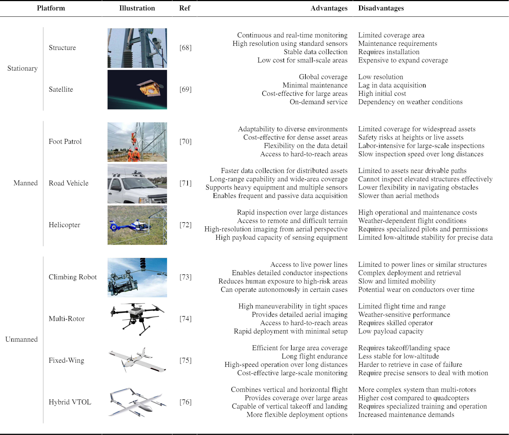
  <figcaption>
    Overview of Means and Platforms used for Electrical Grid Asset Inspection Tasks.
  </figcaption>
</figure>

**Scale and Distance**
- Match distance to defect size: helicopters and fixed-wing stand off for meter-scale tilt, sag, and clearance; multirotor and VTOL close in for centimeter-scale insulator and fitting damage; climbing robots and VTOL resolve millimeter-scale cracks, pins, and wire strands.
- Design acquisition for downstream analysis, not the reverse: close-ups miss misalignment, high-speed passes miss tiny hardware.

<figure>
  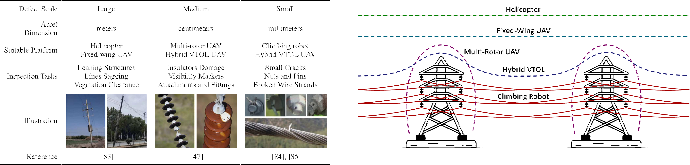
  <figcaption>
    Overview of operational inspection distances for different platforms, adapted from [82]. Helicopters and fixed-wing UAVs require greater safety distances due to low maneuverability. VTOLs can operate closer to power lines and structures, while multi-rotor UAVs excel in localized inspections. Climbing robots are restricted to cable navigation.
  </figcaption>
</figure>

### Data Processing

Scope here is deep-learning vision, from its evolution through development stages to emerging paradigms.

**Deep Vision Evolution**
- Explicit rules gave way to learned classifiers, then automatic extraction with LeNet through AlexNet, VGG, Inception, ResNet residuals, Xception, DenseNet, MobileNet, EfficientNet scaling, and ConvNeXt tuning.
- Sequence modeling moved from bag-of-words through RNN/LSTM to self-attention transformers and BERT; vision followed with patched transformers, distilled data-efficient variants, and shifted-window hierarchies for high resolution.
- Foundation and vision-language models (contrastive pretraining, text-to-image, few-shot, pathwise, promptable segmentation, and recent large multimodal releases) generalize well broadly but underperform on grid imagery with repetitive, subtle, low-contrast defects.

<figure>
  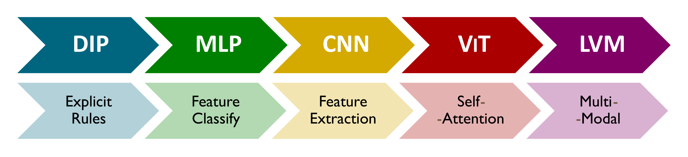
  <figcaption>
  Overview of deep learning evolution applied to computer vision, from explicit rules through feature classification and extraction to self-attention and multimodal learning.
  </figcaption>
</figure>

**Algorithms and Architectures**
- Build stages: handling (sourcing, diversity, splits, balancing; curation, granularity, hierarchy; denoising) → preprocessing (normalization, augmentation, synthesis) → design (blocks, layers, size, residual/dense links, attention/gating) → learning (paradigm, loss, scheduling, regularization) → deployment (pruning, quantization, distillation, latency, edge/cloud) → evaluation (thresholded metrics, error analysis, robustness, ablations).
- Combinations are sparse and interdependent (e.g. contrastive supervised vs. self-supervised with matching losses); data handling such as selection and labeling belongs with data either way and must not be neglected.
- The field over-invests in architecture and learning strategy while undervaluing data, inviting overfit to narrow benchmarks.

**Emerging Methodologies**
- Few/zero-shot transfer, meta-learning, architecture search, and curriculum aim to learn how to learn, but internet-scale training risks test overlap; generative iteration makes experimentation cheap and evaluation the bottleneck, with safety critical.
- Data-centric AI engineers quality, diversity, and labeling over hyperparameters: curated small sets beat big noisy ones, label-error auditing pays, and active learning queries only the most informative samples or relabels.
- Agentic patterns (reflection, tool use, planning, multi-agent collaboration) point toward systems that reassess uncertainty and reacquire data from better viewpoints or modalities.

<figure>
  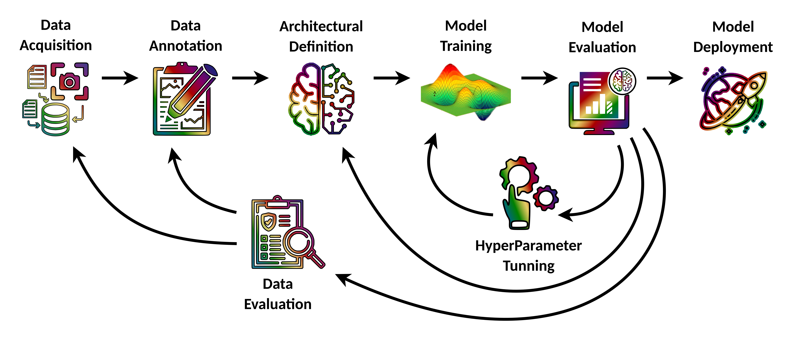
  <figcaption> 
   Overview of model-centric and data-centric approaches. Model-centric feedback loops involve hyperparameter optimization, which may eventually expand to include architectural definition. The data-centric approach introduces an additional feedback loop that extends to earlier stages of model development, aiming to influence not only data annotations but eventually data acquisition as well.
  </figcaption>
</figure>

### Application Scenarios

Coverage is descriptive per asset with comparative tables in the paper, emphasizing task, annotations, and measured performance rather than repeating algorithms.

**Power Generation**

- PV modules (thermal, drone): hotspot detection from thresholding to lightweight detectors; thermal-pattern classification into standard anomaly classes with ensembles, edge quantization, and tracking-based mapping/georeferencing; domain shift handled via contrastive embeddings and nearest-neighbor detection.
<figure>
  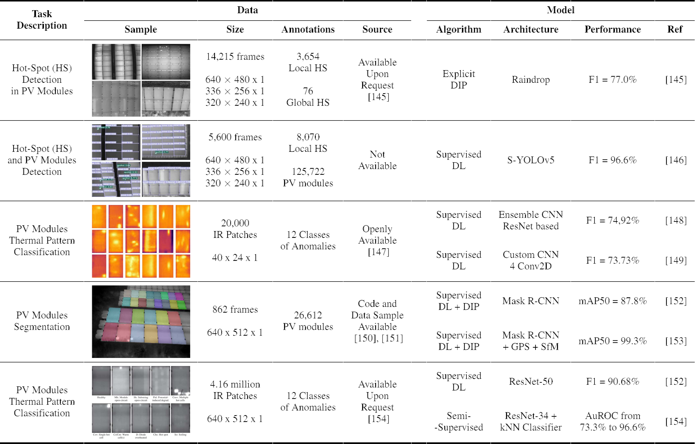
</figure>
 

- PV cells (luminescence, fixed): open electroluminescence sets with confidence-weighted labels; automatic segmentation for classification; large industrial anomaly sets with refined boxes; merged-class and synthetic balancing plus semi-supervised student-teacher training.
<figure>
  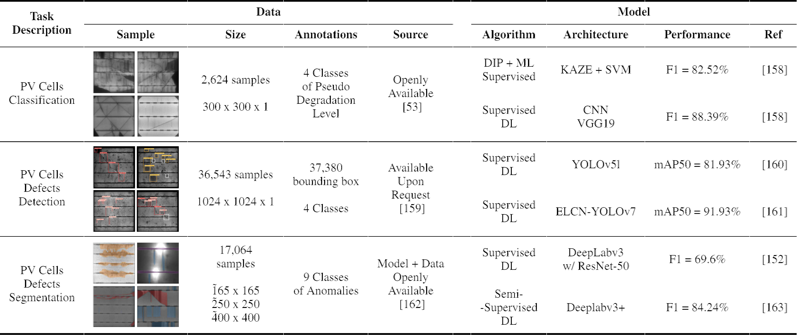
</figure>

 

- Wind blades (visible/thermal, drone): public high-resolution damage sets where patching and finer-grained boxes matter most; stitched full-blade reconstruction for sub-millimeter coverage; background masking for savings; visible-plus-thermal fusion to reject false damage.
<figure>
  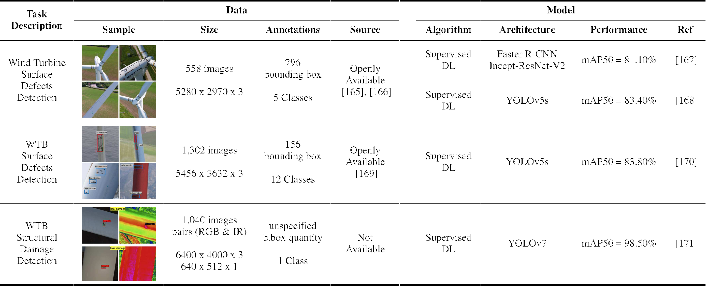
</figure>
 

- Dam walls (visible, climbing/ROV): patch classification with pseudo-localization; lightweight underwater segmentation with physical crack sizing; multi-defect segmentation plus 3D reconstruction and counting; synthetic underwater translation with leakage and direct-from-latent caveats.
<figure>
  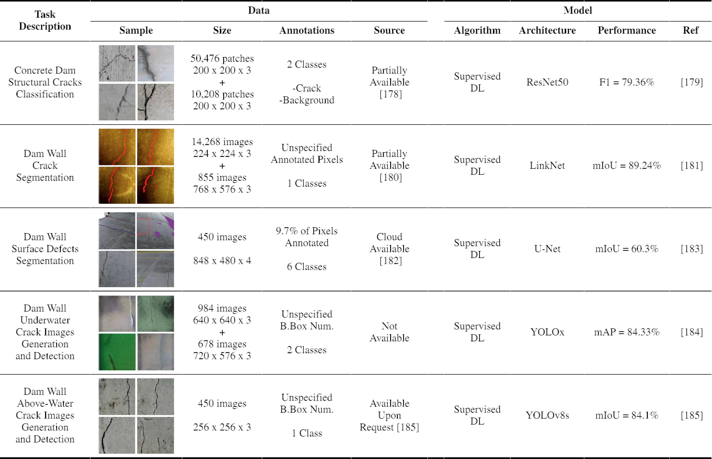
</figure>
 

**Transmission and Distribution**
- Conductors and structures (LiDAR, drone): rural-scale point datasets with explainable tiny models vs. heavy transformers; symmetry-aware segmentation; real-time reflectivity/geometry classification; autonomous extraction/modeling and hazard-distance reporting; vendor tools for classification and sag/tilt measurements.
<figure>
  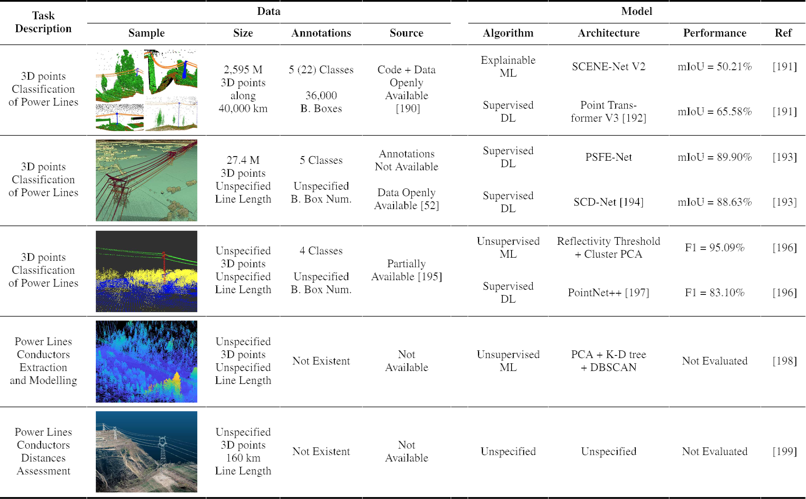
</figure>
 

- Vegetation and foreign objects (satellite, drone, tower stereo): satellite-plus-LiDAR hybrid indices; orthomosaic ensembles; calibrated stereo ranging; synthetic foreign-object sets with strong detectors but false-alarm and overfit risks; integrated navigation-plus-detection pipelines.

<figure>
  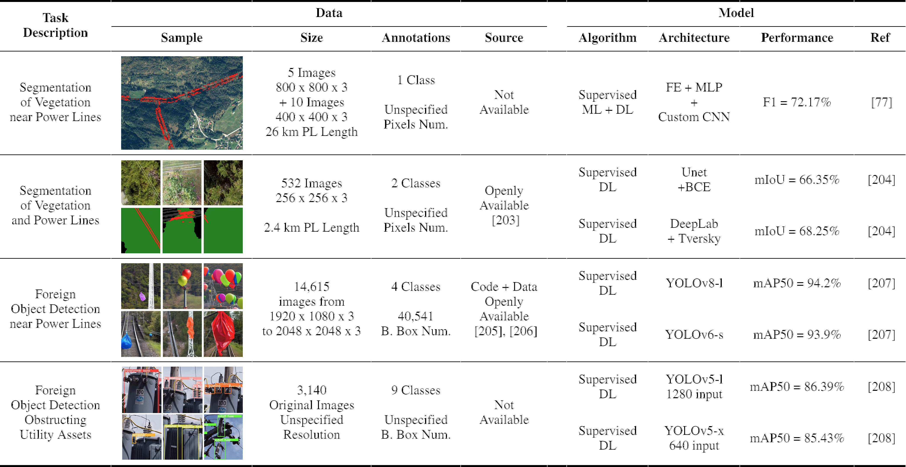
  <figcaption>
</figure>
 

- Insulators and components (visible, drone): close-up defect sets with careful validation splits; disc-level relabeling; cascade string-then-defect designs needing end-to-end scores; synthetic and game-engine sets useful but diversity-limited; unsupervised reconstruction baselines; broken-insulator redesigns; merged multi-source sets with same-asset leakage; multi-asset sets for detection, classification, and imbalance-aware anomaly detection; rust, corrosion, occlusion/scale studies, ultrasmall-bolt and wire-damage detectors.

<figure>
  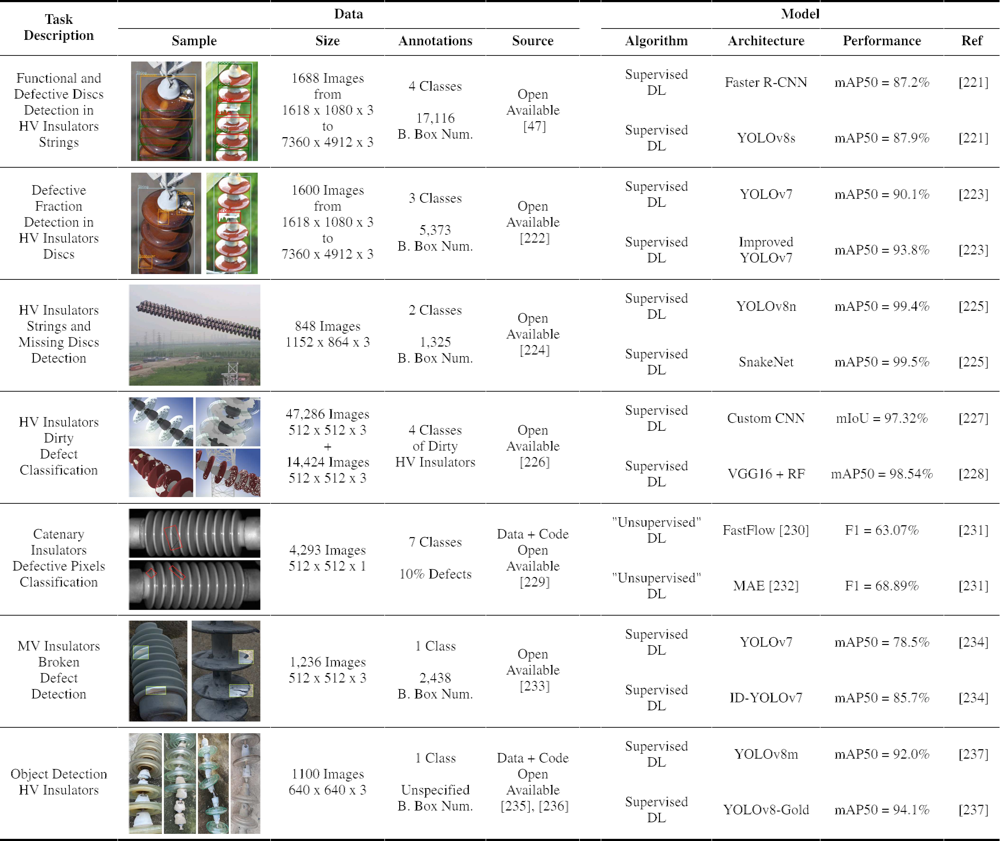
</figure>

<figure>
  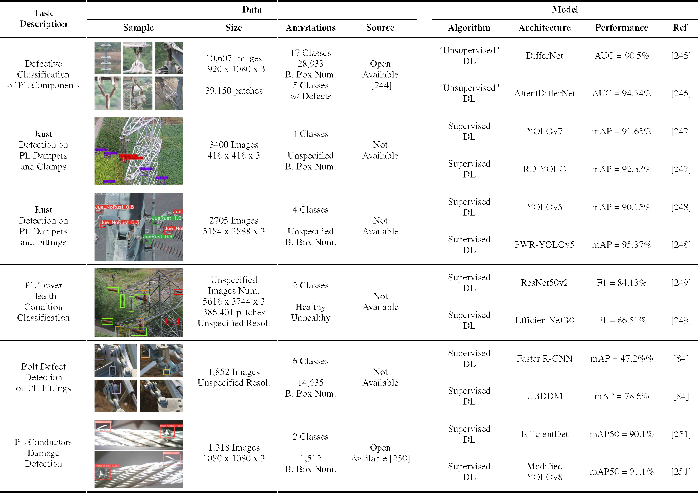
</figure>
 

- Substations and transformers (thermal/ultraviolet, fixed): smart thermal cameras with severity thresholds and asset detectors; improved detectors with robustness checks; instance segmentation plus temperature rules; box-to-mask weakly supervised segmentation toward multimodal condition assessment; corona mode studies from visible patterns to daylight ultraviolet systems; large weakly supervised substation segmentation sets.

<figure>
  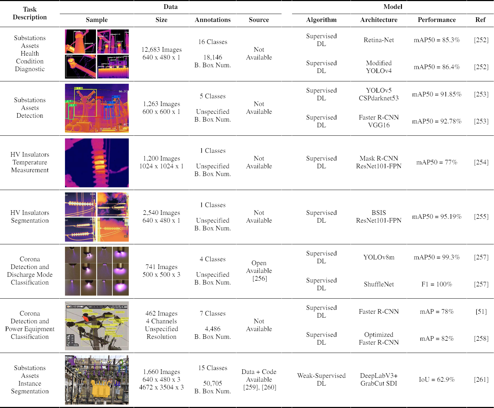
</figure>
 

### Current Challenges

The blocker is not generic model issues (annotation cost, efficiency, interpretability) but inadequate system decomposition. Poor interfaces leave data quality unclear, leakage unnoticed such as augmentation before splitting, cascades evaluated only per-component, and models validated off-distribution — yielding high benchmarks with little operational value.

**Data Quality Measurement**
- Poor interfaces push complexity downstream: modeling around glare and occlusion or detecting small defects in low-resolution images instead of fixing acquisition.
- Large does not mean diverse: coverage of defect types, lighting, and viewpoints matters; pruning redundant and over-represented data speeds training and avoids degradation.
- Annotation quality means consistency through procedures and frameworks plus spatial granularity and semantic detail of categories.
- Fix with flexible interfaces and feedback loops; curate to real-world defect distributions and prioritize high-risk scenarios.

**Operational Viability**
- Automation carries development, maintenance, integration, failure-handling, false-alarm, and scalability costs; surpassing humans remains work in progress.
- Automate by frequency times impact: rare low-impact anomalies favor manual sampling; frequent high-impact failures justify investment by preventing cascading outages.
- Isolated processing optimization drifts into synthetic and simulated targets with no real examples and detections without feasible actions — transient cases versus static actionable ones — so align detection with maintenance goals.

**Performance Evaluation**
- Verification (does it run as intended) without validation (does it solve the right problem) yields precise but valueless models: box accuracy matters less than defect existence if no action follows.
- Overfitting to synthetic and augmented sets breaks field generalization; training compact and testing on diverse realistic data exposes it better.
- Missing shared models, data, and code blocks replication and scaling; imbalanced classes call for frequency-times-impact-weighted metrics where small gains on common severe defects outweigh rare-anomaly wins.

### Future Directions

Deep vision can transform reliability, safety, and cost, but only with scale-ready data handling, robustness, and integration for live monitoring and predictive maintenance. The proposal is a data-centric ecosystem: embedded validation at capture, multimodal domain transfer, and active adaptation.

**Embedded Vision**
- Public sets suit model fitting, not deployment; blurring and glare must be caught at capture with full surface coverage.
- Flow: inspection order → flight control to optimal pose → acquisition → quality check on sharpness and contrast → valid new data → quantity check on coverage → finished collection.
- Operators already do this well, so near-term value is modest — but embedding it is prerequisite for autonomous aircraft.

**Multimodal Data**
- General multimodal models lack grid domain knowledge and tailored data; fuse modalities to transfer it.
- Time-series (climate, electrical measurements, maintenance records) complements thermography; structured metadata (topology, voltage, circuits, insulator types) constrains predictions to valid categories.
- Visual modes reinforce each other: point clouds and depth separate foreground for detection; records build domain vocabulary and balance datasets.

**Active Learning**
- With limited data and noisy benchmarks, prioritize informative samples over volume.
- Loop: unlabeled data → deployed-model inference → confidence-ranked output → human validation → labeled pool → latent-similarity selection for diversity → training set → retraining → improved deployment, repeated continuously.
- Reporting closes the loop: dynamic and periodic updates of findings, measurements, and geospatial layers into an asynchronous digital twin with database growth.

<figure>
  
  <figcaption>
  Proposed automated ecosystem integrating embedded vision and data-centric multimodal active learning methodologies. The embedded vision system validates both the quantity and quality of the acquired data. Spatial and time-series data are combined into a multimodal input to leverage domain knowledge transfer. The model's iterative development incorporates a human validator and training data selection within an active learning paradigm. Efficient reporting of asset conditions is achieved through a digital twin interface.
  </figcaption>
</figure>

### Conclusion

- Synthesis from economic and policy drivers through grid systems, assets, acquisition, deep-vision evolution, and cross-asset applications.
- Shared lesson: limited diversity plus inconsistent validation makes generalization hard to distinguish from overfitting; benchmark scores overstate operational readiness.
- Path forward: validate at capture, fuse domain modalities, and close the loop with human-in-the-loop selection for accurate, scalable, maintenance-actionable inspection.
- Call: shared models, open datasets and code, and researcher–operator collaboration to ship systems that inform maintenance, not just score well.

---

## Journal Paper

<iframe
  src="paper_IEEE_Access_Review_CV_Electrical_Assets_Pedro_Daniel_Rocha.pdf#toolbar=0&view=Fit&navpanes=0"
  width="100%"
  style="aspect-ratio: 1 / 1.414; border: none;">
  
This browser does not support PDFs. Please download the PDF to view it:
    <a href="paper_IEEE_Access_Review_CV_Electrical_Assets_Pedro_Daniel_Rocha.pdf">Download PDF</a>.
  

</iframe>

---
