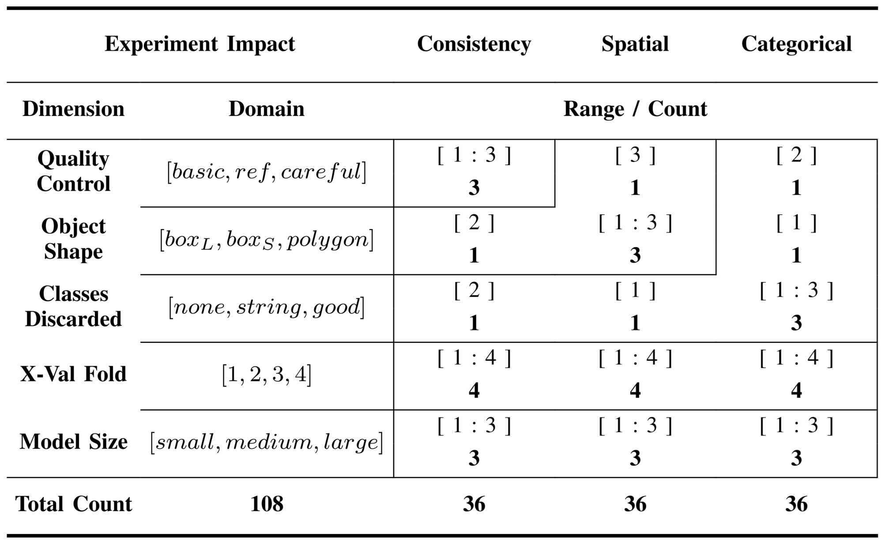
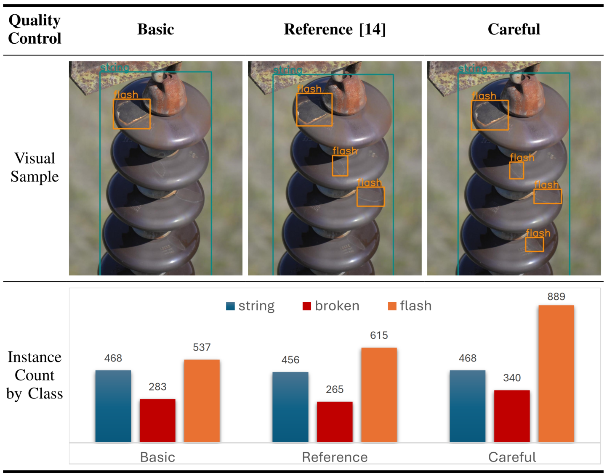
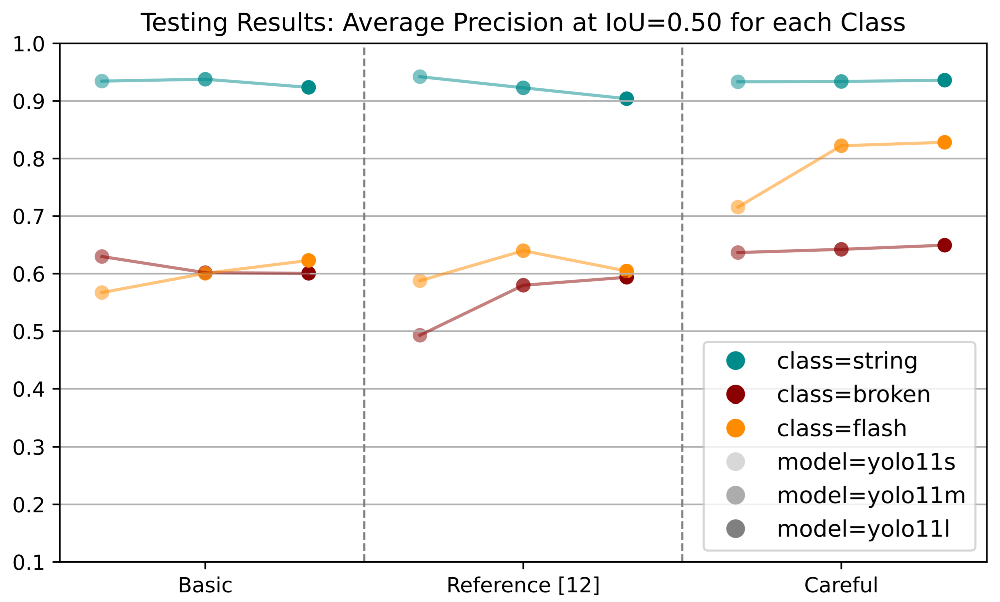
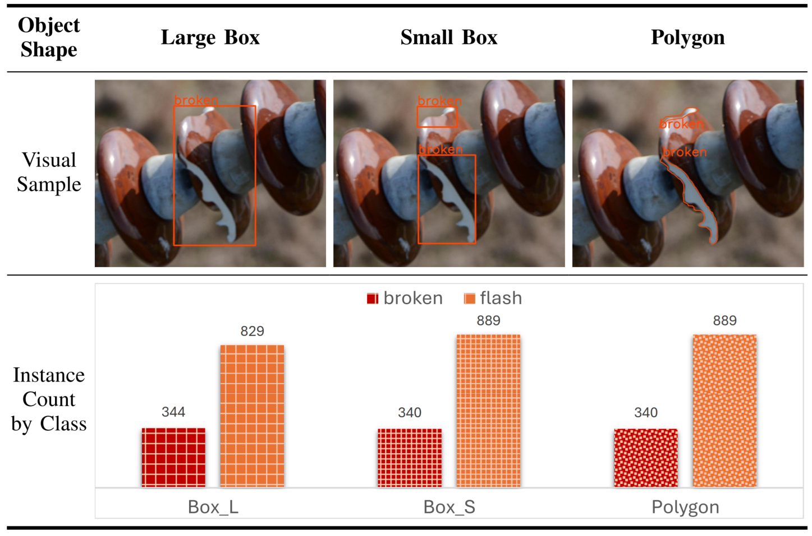
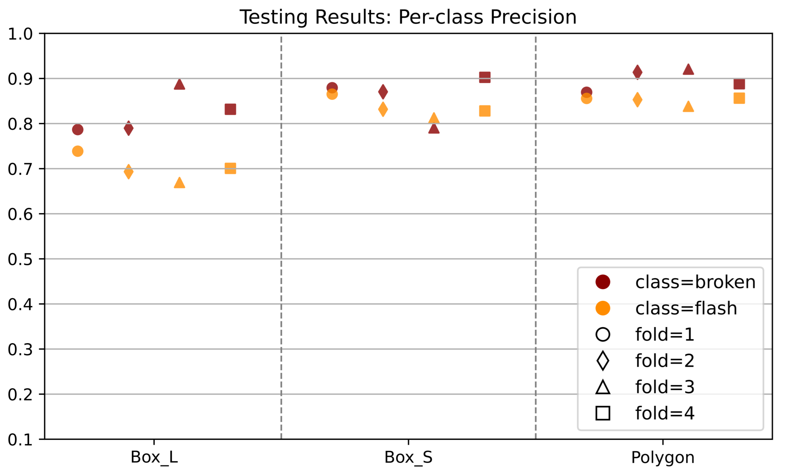
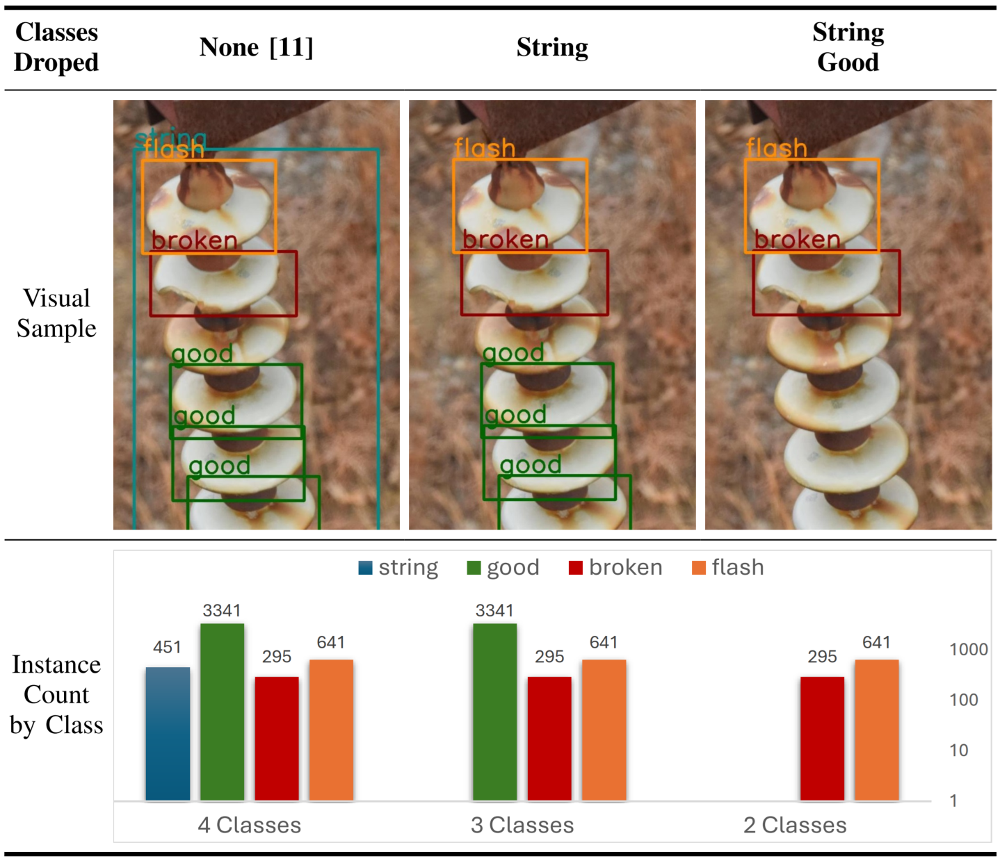
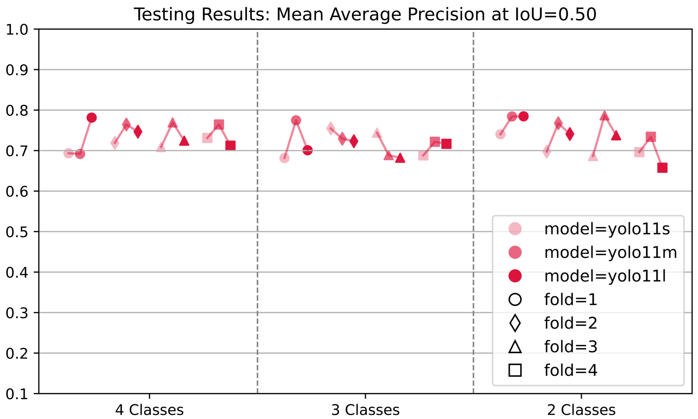

<!-- Add the paper text or supplementary notes. Markdown, math, and code are supported. -->
---

> **Copyright notice:** © 2025 IEEE. Personal use of this material is permitted. Permission from IEEE must be obtained for all other uses. The published version is available via [IEEE Xplore](https://doi.org/10.1109/ISPA66905.2025.11259463).

---

## Overview

Data-centric study of annotation quality: 108 YOLOv11 models fine-tuned on IDID, varying only how the data was labelled — never the architecture.

### Method

Three quality dimensions, each evaluated in isolation:

- **Labelling consistency** — noise mitigation via a strict QC policy: `basic` vs `reference` vs `careful`.
- **Spatial granularity** — geometry: large box (`boxL`) vs small box (`boxS`) vs `polygon`.
- **Categorical definition** — class count: 4 classes vs 3 vs 2 defective-only.

Three levels per dimension × 4 cross-validation folds × 3 model sizes (YOLOv11 s/m/l) = 36 models each, **108 trained models** in total. Primary metric: AP50. Inference 11.9–35.4 ms/image (small–large).

<figure>
  
  <figcaption>
  Experiment design: one dimension varied per experiment while the others are held fixed, giving 108 trained models.
  </figcaption>
</figure>

### Data

- **IDID:** 400 unique images (1,600 with offline mirroring); classes: String Insulator, Good Disc, Broken Disc, Flashover Shell.
- High-resolution, close-up views of real operational environments.
- Separate test set of 88 images, annotated by the authors with a careful QC policy.

### Results

#### Annotation Consistency

**Key takeaway: missing annotations penalize recall.**

- Only `careful` labelling achieved high recall; `string` is unaffected, since the QC threshold does not apply to functional assets.
- `flash` reaches AP50 = 82.82% under careful QC (889 instances), while `broken` drops to 49.3% in the reference set (265 instances).

<figure>
  
  <figcaption>
  Quality-control levels — basic only flags obvious defects, careful also labels subtle ones — with instance counts per class.
  </figcaption>
</figure>

<figure>
  
  <figcaption>
  AP50 per class across QC policies (cross-validation folds averaged). Higher instance counts under careful labelling lift the defective classes.
  </figcaption>
</figure>

#### Spatial Granularity

**Key takeaway: improving tightness favours precision.**

- Similar recall across variants, but precision rises from `boxL` → `boxS` → `polygon`.
- Raising the IoU threshold penalises box annotations more than polygons.

<figure>
  
  <figcaption>
  Object-shape levels — large box, small box (inscribed in the polygon), and polygon — with instance counts per class.
  </figcaption>
</figure>

<figure>
  
  <figcaption>
  Per-class precision across object shapes (averaged over model sizes). Tighter boundaries reduce background false positives.
  </figcaption>
</figure>

#### Categorical Definition

**Key takeaway: irrelevant labelling seems unnecessary labour.**

- High variance across model and fold dimensions, but no trend linking extra functional classes to better defect detection.
- Annotated functional assets do not necessarily improve detection of defective ones.
- This assumption is challenged by our later [ICIP 2026](https://doi.org/10.1109/ICIP61757.2026.11630265) work, which shows non-defective asset labels do help on a different dataset.

<figure>
  
  <figcaption>
  Class subsets — 4, 3, and 2 classes — with instance counts. `good` dominates the annotations (3,341 instances).
  </figcaption>
</figure>

<figure>
  
  <figcaption>
  mAP50 across class counts, averaged over classes. No systematic trend — adding functional classes does not improve defective-class detection.
  </figcaption>
</figure>

### Takeaways

- **Annotation consistency → recall:** missing annotations penalize recall; careful QC yields the best AP50 on defective classes.
- **Spatial granularity → precision:** tighter labels favour precision, as background false positives are reduced.
- **Categorical definition → no measurable impact:** adding functional asset classes does not improve defective-class detection.
- Development scores can be inflated: 94.8% mAP50 on validation (4 classes) drops to 78.1% on the defective-only test set (2 classes).
- Higher data quality reduces the need for large quantities of annotated data.

---

## Conference Paper

A self-archived accepted manuscript is provided below.  
The published version is available in [IEEE Xplore](https://doi.org/10.1109/ISPA66905.2025.11259463).

<iframe 
  src="paper_ISPA_2025_Annotations_Impact_Pedro_Daniel_Rocha.pdf#toolbar=0&navpanes=0&view=FitH" 
  width="100%" 
  style="aspect-ratio: 1 / 1.294; border: none;">
  
This browser does not support PDFs. Please download the PDF to view it: 
    <a href="paper_ISPA_2025_Annotations_Impact_Pedro_Daniel_Rocha.pdf">Download PDF</a>.
  

</iframe>

---

## Conference Slides

<iframe 
  src="slides_ISPA_2025_Annotations_Impact_Pedro_Daniel_Rocha.pdf#toolbar=0&navpanes=0&view=FitH" 
  width="100%" 
  style="aspect-ratio: 4 / 3; border: none;">
  
This browser does not support PDFs. Please download the PDF to view it: 
    <a href="slides_ISPA_2025_Annotations_Impact_Pedro_Daniel_Rocha.pdf">Download PDF</a>.
  

</iframe>

---
