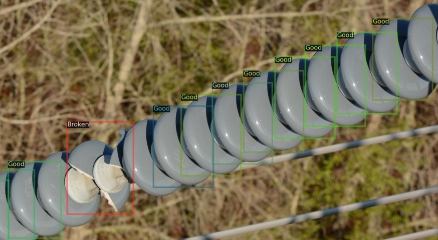
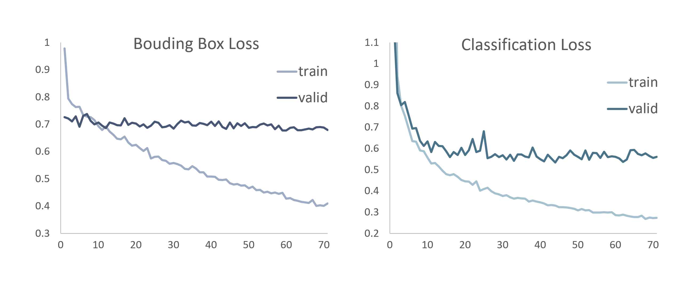
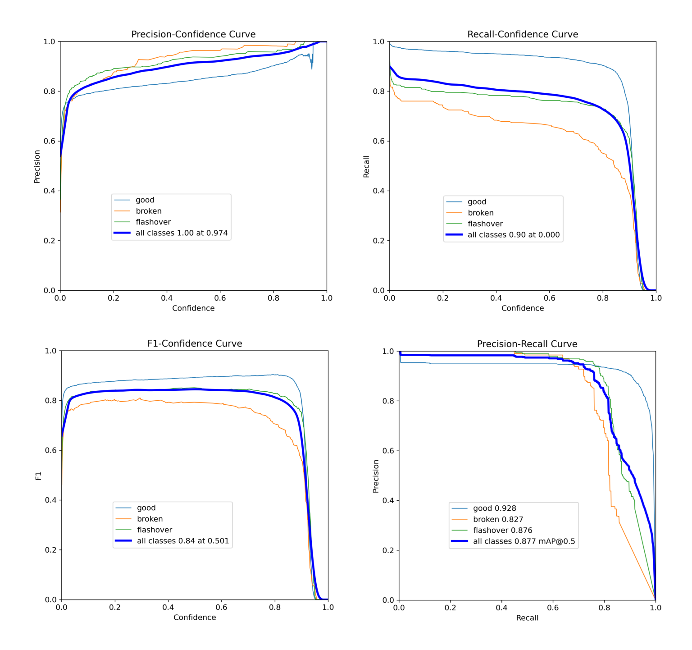
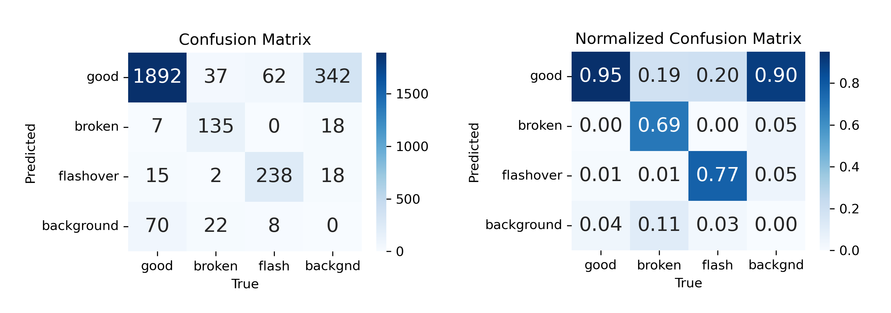
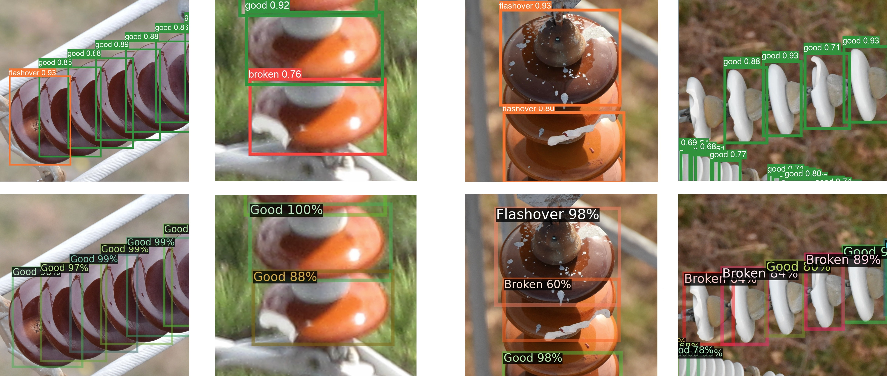

<!-- Add the paper text or supplementary notes. Markdown, math, and code are supported. -->
---

> **Copyright notice:** © 2024 IEEE. Personal use of this material is permitted. Permission from IEEE must be obtained for all other uses. The published version is available via [IEEE Xplore](https://doi.org/10.1109/SmartGridComm60555.2024.10738034).

---

## Overview

First-step evaluation toward low-complexity models for smart-grid integration. Two state-of-the-art detectors are compared on high-resolution HV-insulator imagery: one-stage YOLOv8s vs two-stage Faster R-CNN X101-FPN.

### Data

- **IDID (EPRI):** 1,600 files, 17,116 instances (78% good, 15% flashover, 7% broken), but only 400 unique images plus mirrored copies.
- Validation split carefully separated (15%) to avoid mirrored leakage between train and valid.
- Edge-cropped discs and good discs adjacent to broken ones are often not annotated, which bounds metric reliability.

<figure>
  
  <figcaption>
  IDID annotation gaps: edge-cropped discs and adjacent good discs left unannotated.
  </figcaption>
</figure>

### Experiment

- Early comparative experiment, no novel method — off-the-shelf detectors with standard training:
  - YOLOv8s, 1024px input, 100 epochs, batch 32, default Ultralytics augmentation.
  - Faster R-CNN X101-FPN, short edge 640–800px, batch 4 images, default Detectron2 augmentation.
- Classes: good (functional), broken (defective disc), flashover (defective shell).
- Extra qualitative test on 88 non-annotated IDID images plus 24 private EDP MV-line images.

### Results

- Validation mAP50: YOLOv8s 87.9% (good 92.9%, broken 82.7%, flashover 88.0%) vs Faster R-CNN 87.2% (good 94.3%, broken 83.0%, flashover 84.2%).
- YOLO converges with best validation at epoch 56 (early stop at 71); box loss improves only slightly from pre-trained weights, class attribution improves most.
- Faster leads slightly on classification for good/broken, YOLO leads on box regression (mAP50-95 decay) and generalizes better to blurred EDP images.

<figure>
  
  <figcaption>
  YOLOv8s training dynamics: box and classification loss, train vs valid. Valid stalls after epoch 56.
  </figcaption>
</figure>

<figure>
  
  <figcaption>
  YOLOv8s validation curves. Broken is conservative but precise (high precision, lower recall); good has highest recall.
  </figcaption>
</figure>

<figure>
  
  <figcaption>
  Confusion at 0.25 confidence. Many good predictions on background might reflect missing annotations rather than pure false positives.
  </figcaption>
</figure>

### Qualitative check

- Both models detect functional and defective discs in most test images.
- Typical YOLO confusions: bird droppings vs flashover, occlusions, defocus treated as background, unseen glass insulators.
- Faster struggles more off-focus and in evening light; both show duplicate boxes with different labels on the same object.

<figure>
  
  <figcaption>
  Same scenes, top YOLOv8s vs bottom Faster R-CNN. On the left, YOLO detects a flashover and a broken disc that Faster misses. On the right, YOLO misses several broken discs that Faster detects.
  </figcaption>
</figure>

### Takeaways

- Both detectors are viable for a fully automated first pass; YOLO is the more practical baseline for edge / real-time use.
- Metric reliability is bounded by annotation trustworthiness (missing boxes, coarse geometry).
- Next steps from this early experiment: high-quality dataset, domain-specific architectures, low-complexity edge models.

---

## Conference Paper

A self-archived accepted manuscript is provided below.  
The published version is available in [IEEE Xplore](https://doi.org/10.1109/SmartGridComm60555.2024.10738034).

<iframe
  src="paper_SmartGridComm24_An_Application_to_HV_Insulators.pdf#toolbar=0&navpanes=0&view=Fit"
  width="100%"
  style="aspect-ratio: 1 / 1.294; border: none;">
  
This browser does not support PDFs. Please download the PDF to view it:
    <a href="paper_SmartGridComm24_An_Application_to_HV_Insulators.pdf">Download PDF</a>.
  

</iframe>

---
